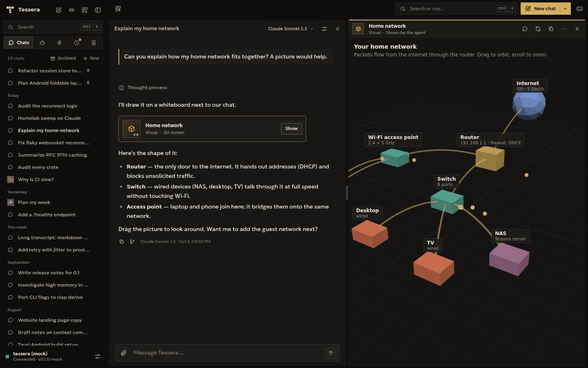

# Tessera

Tessera is an AI agent you run yourself. It lives on your own computer or home
server, works on long tasks for you (code, research, the web, notes), and you
use it from a desktop app, your phone, a terminal or a browser. Every
connection is end-to-end encrypted.



## Why Tessera

- **Yours.** Chats, keys and memory stay on your hardware. Use the AI you
  already have: a Claude or ChatGPT plan, an API key, or models running on
  your own computers.
- **Made for long work.** Every step is saved as it happens. Close the app and
  the agent keeps working; open it on any device and pick up where it is.
- **Safe by default.** The AI never sees your passwords, commands run in a
  sandbox, risky actions ask you first, and only your paired devices get in.
- **Light.** One small program. No Docker, Python or Node needed, and it runs
  well on an old server or a small VM.

## Install

**Linux and macOS**

```bash
curl -fsSL https://github.com/KC-ctrl095/Tessera/releases/latest/download/install.sh | sh
```

**Windows 10 and 11:** download `tessera-desktop-windows-x86_64-setup.exe`
from the [latest release](../../releases/latest) and run it. Or, for the
server and terminal only, in PowerShell:

```powershell
irm https://github.com/KC-ctrl095/Tessera/releases/latest/download/install.ps1 | iex
```

**Android:** install `tessera-android-arm64.apk` from the
[latest release](../../releases/latest). The app connects to your Tessera
server; it doesn't run one.

The installer checks every download against the release's checksums and puts
everything in your home folder. It then offers `tessera setup`, which walks
you through choosing an AI, where you'll use Tessera, and pairing your phone.
Nothing is opened to your network or the internet unless you choose it.

## Use it

```bash
tessera                          # chat in this terminal
tessera pair                     # add a phone or another computer
tessera run "summarise this folder"
tessera setup                    # change the setup any time
```

Run the install command again to update.

## What it can do

- **Code:** read, edit and search code, run commands, and split work across
  helpers that run in parallel.
- **Browse with you:** a shared browser on your computer and phone. The agent
  hands a page over when only you can act on it, like a sign-in.
- **Show you things:** whiteboards, notes you edit together, and files sent
  to your phone.
- **Remember:** what it learns about you and your projects, and procedures
  that worked. You can see and change all of it.
- **Bots and schedules:** named bots with their own tools and memory, and
  jobs that run on a schedule.
- **Your other computers:** let agents build and test on another machine,
  only in the folders you allow.

The [guide](docs/GUIDE.md) covers everything, including shortcuts and
settings.

## Security

- Devices pair once and talk to your server end-to-end encrypted, even
  through a tunnel or proxy.
- Passwords and keys live in a vault on the server. A command gets one only
  when it names it, and secret values are removed from everything the model
  reads.
- On Linux, the agent's commands run in a sandbox that can't see Tessera's own
  keys, chats or settings. Windows has no sandbox yet, so commands ask first.
- Your Claude plan is used only through your own, unmodified Claude Code.

Details: [docs/SECURITY.md](docs/SECURITY.md). To report a vulnerability,
see [SECURITY.md](SECURITY.md).

## Platforms

| | Server and terminal | App |
|---|---|---|
| Linux (x86_64, ARM64) | Yes | Desktop app on x86_64 |
| macOS (Apple silicon, Intel) | Yes (`tessera serve`, no background service yet) | Browser |
| Windows 10 and 11 (x86_64) | Yes | Desktop app |
| Android 7.0+ (ARM64) | No | Android app |
| Any browser | No | Yes, once you turn on browser access in Settings |

## Build from source

You need Rust 1.88 or newer and Node.js 22.

```bash
git clone https://github.com/KC-ctrl095/Tessera
cd tessera
sh scripts/install.sh
```

To build by hand, run the checks, or build the apps, see
[CONTRIBUTING.md](CONTRIBUTING.md) and [docs/TESTING.md](docs/TESTING.md).

## Documentation

[Guide](docs/GUIDE.md) · [Security](docs/SECURITY.md) ·
[Remote access](docs/REMOTE_ACCESS.md) · [Claude Code](docs/CLAUDE_CODE.md) ·
[Other computers](docs/MACHINES.md) · [Windows](docs/WINDOWS.md) ·
[Architecture](docs/ARCHITECTURE.md) · [Protocol](docs/PROTOCOL.md)

## Contributing

Issues and pull requests are welcome. [CONTRIBUTING.md](CONTRIBUTING.md)
explains how to build, test and send a change. Please report security
problems privately, as [SECURITY.md](SECURITY.md) explains.

## License

Apache License 2.0. See [LICENSE](LICENSE) and [NOTICE](NOTICE).

Tessera comes with no warranty. Its agents act on real computers, accounts
and data, and what they do is your responsibility ([terms](TERMS.md)).
Tessera has no telemetry ([privacy](PRIVACY.md)). It is an independent
project, not affiliated with Anthropic, OpenAI or any other company whose
service it works with.
